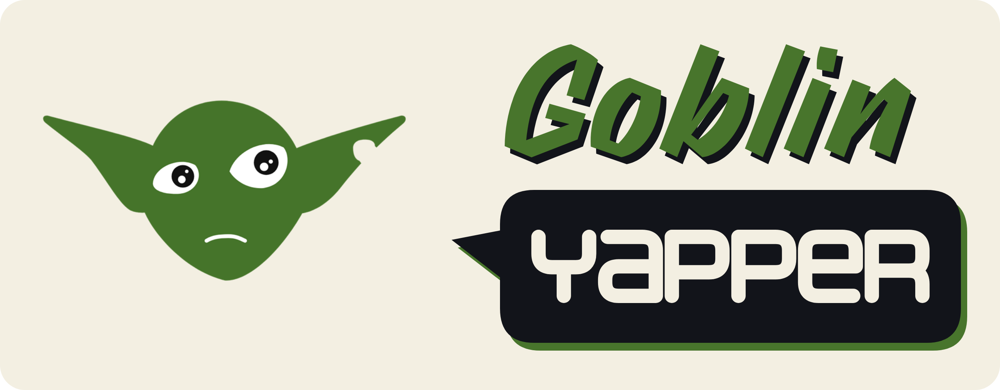

# Goblin Yapper

> **English:** this README in English: [README.md](README.md).

Um app para lives na Twitch: o chat entra numa fila com `!joinsort`, você sorteia os times, e quem você escolhe
**ganha a voz**: as mensagens dessa pessoa são lidas em voz alta e o goblin do time dela fala na tela do OBS.

- **Sorteio de times**: até 4 times (azul, verde, roxo, amarelo), equilibrados; dá para arrastar pessoas entre
  times, sortear de novo e incluir quem chegar atrasado.
- **Voz**: dê a voz a alguém aleatório de um time, ao próximo do mesmo time ou a uma pessoa específica.
  As vozes podem ser clonadas a partir de um áudio seu (OmniVoice, rodando na sua GPU).
- **Overlay do OBS**: um goblin por time, tingido com a cor do time, que se mexe enquanto fala. Use o goblin
  embutido ou as suas próprias imagens (png parado + gif falando).

Lê o chat de forma anônima: não precisa fazer login na Twitch. A interface existe em português (Brasil) e em
inglês: escolha em **Idioma**, no canto superior direito do painel (até você escolher, ela segue o idioma do Windows).

## Download e instalação

1. Baixe o instalador `.msi` no seu idioma na [página de releases](https://github.com/NegentropyBeing/goblin-yapper/releases/latest):
   `…_x64_pt-BR.msi` (português) ou `…_x64_en-US.msi` (inglês). Os dois instalam o mesmo app; o arquivo só define o
   idioma do próprio instalador. O idioma do app é escolhido à parte, no painel.
2. Abra o arquivo. O instalador não é assinado, então o Windows SmartScreen pode avisar:
   clique em **Mais informações → Executar assim mesmo**.

Requisitos:
- Windows 10 ou 11 (64 bits).
- Para a voz clonada (OmniVoice): uma GPU NVIDIA é recomendada (testado numa RTX 5070) e cerca de 11 GB livres
  em disco. Sem GPU ela roda no processador, bem devagar. As vozes do Windows funcionam em qualquer PC.

## Como usar

1. **Conecte ao chat**: digite o nome do canal (ou cole o link) no campo **canal da twitch** e clique em
   **Conectar**.
2. **Monte os times**: escolha quantos times, clique em **Abrir fila** e peça para o chat digitar `!joinsort`.
   Clique em **Sortear**. Depois disso, quem entrar vai direto para o menor time.
3. **Dê a voz**: clique em **🎤 Sortear voz** em um time (pessoa aleatória daquele time) ou no 🎤 ao lado de
   um nick (aquela pessoa). **⏭ Próximo** passa a voz para outra pessoa do mesmo time e **⏹ Parar** tira a voz
   do time; **Parar voz**, no topo, corta tudo.
   Com **vários times ao mesmo tempo** ligado, cada time pode ter alguém com a voz; as falas tocam uma de cada vez.
   **🔊 Testar voz**, em cada time, faz o goblin do time dizer uma frase fixa com a voz daquele time.
4. **Coloque no OBS**: abra **Overlay do OBS e imagens do goblin**, copie a URL de cada time e adicione uma
   **Fonte de navegador** no OBS para cada uma.
5. **Configure a voz** (aba **Voz**): na primeira vez, clique em **Instalar servidor de voz**. Ele baixa tudo
   o que precisa (~3,5 GB, mais ~3 GB do modelo ao iniciar pela primeira vez); não é preciso instalar Python.
   Depois, crie perfis de voz e escolha qual perfil cada time usa.

### Comandos do chat

| comando | o que faz |
|---------|-----------|
| `!joinsort` ou `!joinsorting` | Entra na fila (só com a fila aberta). Depois do sorteio, entra direto no menor time. |
| `!leavesort` | Sai da fila ou do time. |

Quem está com a voz não digita comando: as mensagens normais são lidas. Mensagens que começam com `!`, links e
emotes não são lidos, e no máximo 5 mensagens ficam esperando; o resto é descartado. As tags de fala também
funcionam no chat: `essa foi por pouco [laughter]` faz o goblin rir.

### OBS

- **Uma fonte por time**: `http://127.0.0.1:8765/overlay?team=azul` (fundo transparente; o app precisa estar
  aberto). Cada fonte mostra o goblin do seu time, que só se mexe e só toca som nas falas **daquele time**.
- **Fonte principal** (opcional): `http://127.0.0.1:8765/overlay` mostra quem estiver falando e toca as falas
  dos times que não têm fonte própria e de quem está sem time.
- Cada fala toca em uma única fonte, então não há som duplicado. No painel, um ponto verde ao lado de cada URL
  indica que a fonte está aberta no OBS. Sem nenhuma fonte aberta, o próprio app toca a fala (bom para testar).
- Ative "Controlar áudio pelo OBS" em cada fonte para ter cada time num canal próprio do mixer.
- **Tamanho**: o goblin ocupa a fonte inteira, com uma faixa embaixo para o nick. Defina o tamanho pela largura
  e altura da própria fonte no OBS; para o goblin embutido, 640 × 400 encaixa bem (640 × 360 sem o nick).
- Outras opções: `?label=0` (esconde o nick e a faixa), `?audio=0` (fonte sem som), `?size=400` (goblin numa
  caixa fixa de 400 px, em vez de ocupar a fonte).
- O painel também funciona como dock personalizado do OBS: `http://127.0.0.1:8765/panel`.

### Imagens do goblin

Na seção **Overlay do OBS e imagens do goblin** há uma linha **Padrão** e uma linha por time, cada uma com um
espaço para o png (parado) e outro para o gif (falando): arraste as imagens ou clique para escolher.

- **Padrão**: vale para todos os times que não têm imagem própria. Cada time recebe esse goblin tingido com a
  sua cor; um goblin neutro ou acinzentado fica melhor tingido.
- **Por time**: um par png + gif só daquele time. A tinta do time continua sendo aplicada por cima: para mostrar
  a arte como ela é, leve a barra de tinta daquele time até o zero.
- Sem imagens, é usado o goblin embutido.

### Perfis de voz

Na aba **Voz**, arraste um `.wav` com a voz a clonar. O app prepara o áudio (corta silêncio, normaliza),
transcreve com o Whisper, e você revisa a transcrição antes de criar o perfil. Dá para testar frases, ajustar
todos os parâmetros do OmniVoice (idioma, velocidade, ...) para todos os perfis ou para um só, e escolher a voz
de cada time. As vozes do Windows também estão disponíveis como alternativa.

**Estilo de voz e tags de fala.** O **＋** ao lado de *Estilo de voz* lista os termos que o OmniVoice entende
(gênero, idade, tom, sussurro, sotaque em inglês), um de cada tipo; ele só tem efeito nas falas sem perfil de voz.
O **＋ tag** ao lado das caixas de teste e da transcrição insere uma tag de fala como `[laughter]` ou `[sigh]`, que a
voz transforma no som.

**Só clone vozes com a permissão de quem fala.**

## Onde ficam os dados

- Configurações, imagens, perfis de voz e log: `%APPDATA%\com.goblinyapper.desktop\` (o painel mostra a pasta
  em **Pasta de dados**).
- Servidor de voz: `%LOCALAPPDATA%\GoblinYapper\voice-runtime\`; o modelo fica no cache do Hugging Face.
- Desinstalar o app mantém essas pastas. Apague-as para remover tudo.

## Desenvolvimento

Para rodar a partir do código-fonte, gerar o instalador, usar a API HTTP ou trocar a engine de TTS, veja
[docs/DEVELOPMENT.pt-BR.md](docs/DEVELOPMENT.pt-BR.md). Notas de design originais: [docs/SPEC.md](docs/SPEC.md).

Vai testar o projeto sem ser programador? Siga o [guia de teste passo a passo](docs/TESTE.pt-BR.md).

## Licença

O código do Goblin Yapper é **MIT** (veja [LICENSE](LICENSE)). Modelos e bibliotecas de terceiros são baixados
separadamente e mantêm as suas próprias licenças; veja o [NOTICE](NOTICE).

- **OmniVoice** (k2-fsa): código Apache-2.0; o **modelo pré-treinado é CC-BY-NC, somente uso não comercial**.
  Usar a voz do OmniVoice em lives monetizadas pode contar como uso comercial; confira os termos do modelo.
  As vozes do Windows não têm essa restrição.
- O tokenizador de áudio do modelo OmniVoice (atribuição exigida, mantida no original em inglês):
  **Built with Higgs Materials licensed from Boson AI USA, Inc., Copyright Boson AI USA, Inc., All Rights
  Reserved and Meta Llama 3 licensed under the Meta Llama 3 Community License, Copyright Meta Platforms, Inc.,
  All Rights Reserved.** Os contratos estão em [third_party/](third_party/); o uso deve seguir a
  [Política de Uso Aceitável do Meta Llama 3](https://llama.meta.com/llama3/use-policy).
- **Whisper** (OpenAI, transcrição): MIT.
